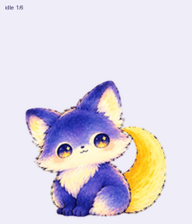
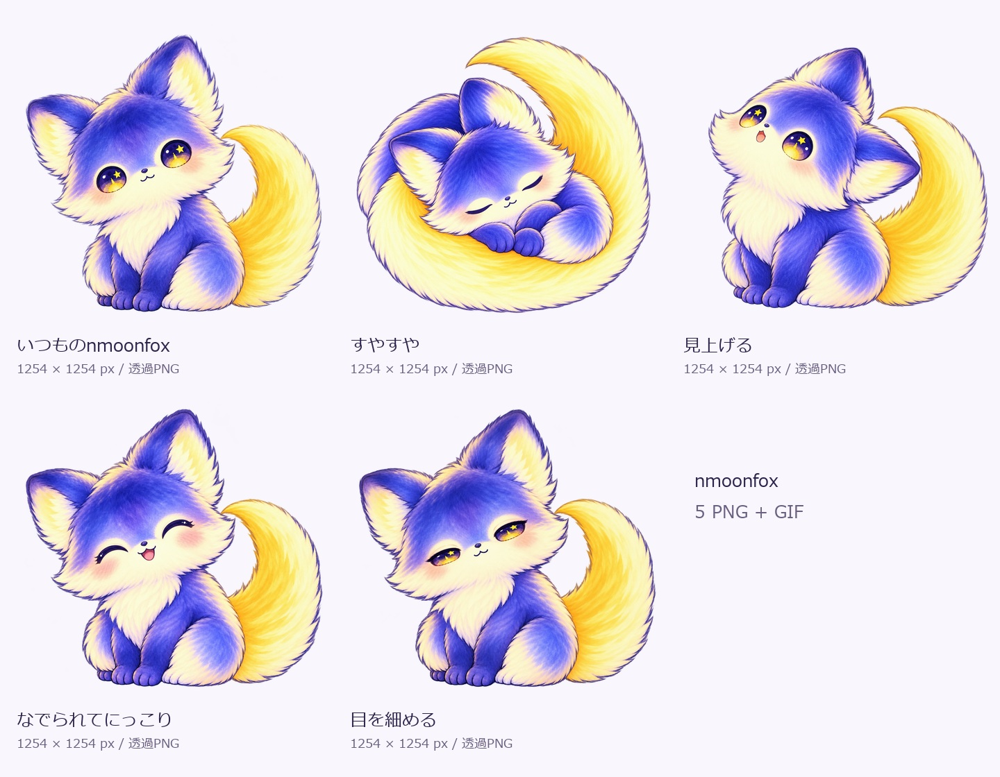
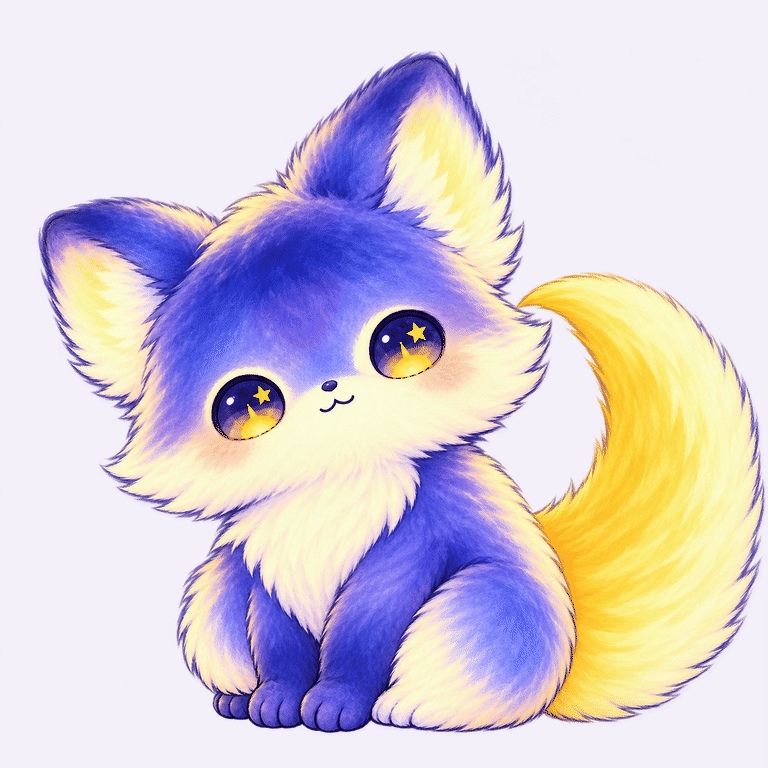
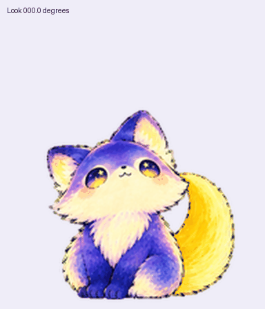
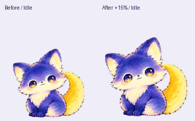

# nmoonfox

夜にそっと寄り添う、三日月のしっぽを持つやさしい月のきつね。
ChatGPT Pets向けのカスタムペットです。藍色の水彩風の毛並み、クリーム色の胸元、星を映す瞳、黄色い三日月のしっぽが特徴です。

**[ChatGPTの共有ペットを開く](https://chatgpt.com/s/sharepet_6ad6e8571d1481918a1f13a8a5d6cf7e)** · **[導入方法](INSTALL.md)** · **[PNGをダウンロード](assets/nmoonfox-v2.png)**



## もふもふ高解像度イラスト集

粒状の筆跡を抑え、柔らかな毛並みに揃えた独立イラストを追加しました。通常姿・すやすや・見上げる・にっこり・目を細める、の透過PNGが5枚（各1254×1254px）と、表情が変わるGIF（768×768px）です。

**[画像集をZIPでダウンロード](https://github.com/Noon-R/nmoonfox/raw/refs/heads/main/downloads/nmoonfox-illustrations-soft.zip)** · **[個別PNGを見る](illustrations/png)** · **[使い方と収録内容](illustrations/README.md)**





ZIPを展開し、`png` フォルダーの画像をお使いください。PNGは背景透過、GIFは淡いラベンダー背景です。内蔵imagegenで生成した実寸の画像で、ペット用コマの拡大ではありません。この画像集は鑑賞・画像素材向けです。ChatGPTペットの導入には下記の共有リンクまたは従来のスプライトを使ってください。

寸法・ハッシュ値は [イラスト用manifest](illustrations/manifest.json)、制作時の指示は [プロンプト集](illustrations/prompts) に収録しています。

## すぐに使う

Pets機能を利用できるChatGPT Workで、次のメッセージを送ってください。

```text
この共有ペット「nmoonfox」を自分のペット一覧に追加して、アクティブにしてください。
https://chatgpt.com/s/sharepet_6ad6e8571d1481918a1f13a8a5d6cf7e
```

共有ペットの取り込み機能が利用できる環境向けの方法です。取り込み機能がない場合は、[手動アップロード手順](INSTALL.md#pngから手動で追加する)をご覧ください。

## 収録内容

- まばたき・呼吸、左右への移動、手を振る、なでられて喜ぶ、しょんぼり、お願い、考える、確認する、の9状態。
- v2版は16方向の視線にも対応。
- 背景は透明。外部プログラムの実行やAPIキーは不要です。

| ファイル | サイズ | 内容 |
| --- | --- | --- |
| [nmoonfox-v2.png](assets/nmoonfox-v2.png) | 1536×2288 px | 9状態＋16方向、73コマ |
| [nmoonfox-v1.png](assets/nmoonfox-v1.png) | 1536×1872 px | 手動アップロード向け互換版、9状態・57コマ |

1コマは192×208 pxです。待機姿勢の本体は高さ約160 px。拡大プレビューでは画素が目立ちます。v1版はv2の先頭9行をそのまま切り出しており、動作の絵柄は同じです。

### 見回す動き



[MP4プレビュー](previews/all-states.mp4) · [動作の静止画](previews/motion-stills.png)

## 動作確認

v2版は透明背景、セル配置、73コマ、視線の方向を検査済みです。左右の移動は全16コマで耳が2つであることを確認し、タッチ反応は接地したまま喜ぶ5コマに変更しました。ChatGPT Petsの登録前検査を通過し、登録済みペットの更新も確認しました。他のアカウントでの共有取り込みは未検証です。

### 1.2.0 の変更

- 全73コマのキャラクターを縦横15％拡大。耳・しっぽの余白を確保し、同じ倍率で統一しました。
- 1.1.0 の耳の修正となでられ反応を引き継いでいます。



### 1.1.0 の変更

- 歩行中に耳が3つに見えていた形を修正。
- 触れたときのジャンプを、目を閉じて頭を傾ける喜びの反応に変更。
- その他の動作と16方向の視線は同じ画像を維持。

形式上の `jumping` 行（0始まりの4行目）に、意図的になでられ反応を収録しています。この版ではジャンプの離地を要求せず、接地と元の待機姿勢へのつながりを確認しています。

視線が正面と横顔を行き来する一部の境界では、顔の変化がやや大きめです。機能の利用可否はアカウント・ワークスペース・アプリによって異なります。

## 制作について

nmoonfoxのキャラクター資料をもとに、AI画像生成で各動作を作成し、切り抜き・配置・検査を行いました。これはコミュニティ制作のペットであり、OpenAIの公式キャラクターではありません。

公開日：2026-10-20。ファイルの寸法・ハッシュ値は [asset-manifest.json](asset-manifest.json) に記録しています。
